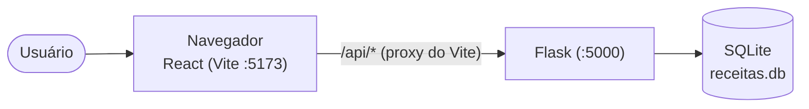
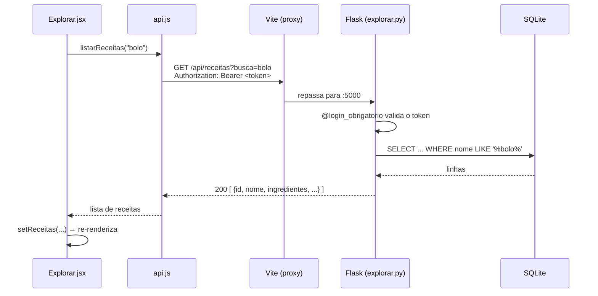
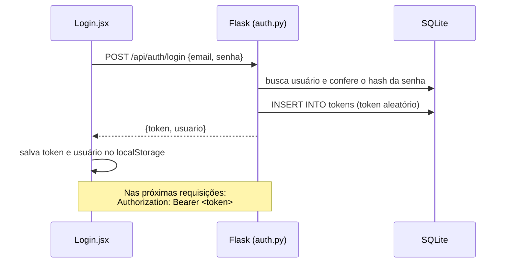

# Arquitetura

## Visão geral

O app é dividido em duas partes que rodam separadas e conversam por HTTP/JSON:



- **Frontend:** React 18 + React Router, empacotado pelo Vite. É uma SPA: o HTML é carregado uma vez e as telas trocam sem recarregar a página.
- **Backend:** API REST em Flask. Cada tela tem o seu *blueprint* (um arquivo de rotas).
- **Banco:** SQLite, um arquivo local criado automaticamente (sem instalar servidor de banco).

## Tecnologias

| Camada | Tecnologia | Uso |
|---|---|---|
| Frontend | HTML + CSS | `index.html` e `styles.css` |
| Frontend | JavaScript + React 18 | Componentes e estado das telas |
| Frontend | React Router 6 | Navegação entre telas e rotas protegidas |
| Frontend | Vite 5 | Servidor de desenvolvimento, proxy `/api` e build |
| Backend | Python + Flask 3 | API REST |
| Backend | Werkzeug | Hash de senha (`generate_password_hash`) |
| Banco | SQLite (`sqlite3` do Python) | Persistência |
| Versionamento | Git + GitHub (Gitflow) | Branches, PRs e quadro Projects |

## Estrutura de pastas

```
app-receitas/
├── README.md
├── docs/                      # esta documentação
├── backend/
│   ├── app.py                 # cria o Flask e registra os blueprints
│   ├── db.py                  # conexão, schema e receitas de exemplo
│   ├── auth_utils.py          # decorator @login_obrigatorio
│   ├── requirements.txt
│   └── routes/                # um blueprint por tela
│       ├── auth.py            # Login        (feature/login)
│       ├── explorar.py        # Explorar     (feature/explorar)
│       ├── cadastrar.py       # Cadastrar    (feature/cadastrar)
│       ├── favoritos.py       # Favoritos    (feature/favoritos)
│       └── lista_compras.py   # Lista        (feature/lista-compras)
└── frontend/
    ├── index.html
    ├── package.json
    ├── vite.config.js         # proxy /api → Flask
    └── src/
        ├── main.jsx           # ponto de entrada do React
        ├── App.jsx            # rotas e proteção de login
        ├── api.js             # TODAS as chamadas ao backend
        ├── styles.css
        ├── components/
        │   ├── Navbar.jsx     # menu do topo + botão Sair
        │   └── EmConstrucao.jsx
        └── pages/             # uma página por tela
            ├── Login.jsx
            ├── Explorar.jsx
            ├── Cadastrar.jsx
            ├── Favoritos.jsx
            └── ListaCompras.jsx
```

### Por que essa divisão?

Cada tela fica isolada em **dois arquivos**: `backend/routes/<tela>.py` e `frontend/src/pages/<Tela>.jsx`. Assim cada integrante trabalha na sua branch mexendo só nos próprios arquivos, e os Pull Requests não geram conflito entre si.

Os arquivos compartilhados (`app.py`, `db.py`, `api.js`, `App.jsx`, `Navbar.jsx`) foram feitos na **base** do projeto e já registram todas as telas. Antes de cada tela ser implementada, os arquivos dela existem como *stub*: o backend responde `501` e o frontend mostra "em construção". A implementação de cada um só substitui o stub.

## Fluxo de uma requisição

Exemplo: o usuário busca "bolo" na tela Explorar.



- As telas **nunca** chamam `fetch` direto: usam as funções de `api.js`, que já põem o token e tratam erros.
- Se o backend responde com erro, `api.js` lança um `Error` com a mensagem do campo `erro` do JSON, e a tela mostra essa mensagem.

## Autenticação

Autenticação simples por **token** (string aleatória guardada no banco):



1. **Cadastro/Login:** o backend gera um token com `secrets.token_hex(24)` e salva na tabela `tokens`.
2. **Frontend:** guarda `token` e `usuario` no `localStorage` (`api.js → salvarSessao`).
3. **Rotas protegidas:** todas, menos registrar/login, usam o decorator `@login_obrigatorio` (`auth_utils.py`). Ele lê o header `Authorization`, procura o token no banco e coloca o id do usuário em `g.usuario_id`. Sem token válido, responde `401`.
4. **Telas protegidas:** em `App.jsx`, o componente `Protegida` manda para `/login` quem não tem token.
5. **401 no meio do uso:** `api.js` apaga a sessão local e manda para `/login`.
6. **Logout:** `POST /api/auth/logout` apaga o token do banco e o frontend limpa o `localStorage`.

**Senhas** nunca são guardadas em texto: o banco tem só o hash (`werkzeug.security.generate_password_hash`).

> ⚠️ É um modelo didático: os tokens não expiram e não há HTTPS. Para produção seria preciso expirar tokens, usar HTTPS e limitar tentativas de login.

## Rotas do frontend

| Caminho | Tela | Protegida? |
|---|---|---|
| `/login` | Login / cadastro de conta | Não |
| `/explorar` | Explorar | Sim |
| `/cadastrar` | Cadastrar | Sim |
| `/favoritos` | Favoritos | Sim |
| `/lista-compras` | Lista de compras | Sim |
| qualquer outro | redireciona para `/explorar` | — |
