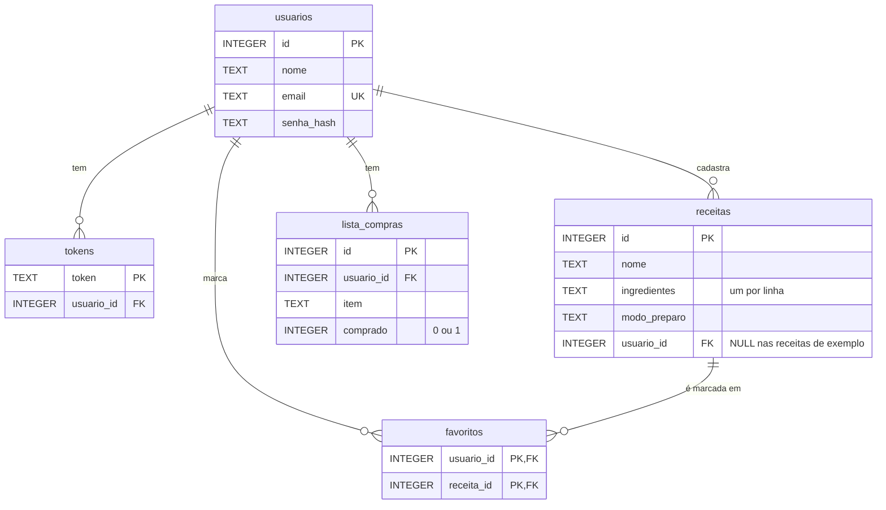

# Banco de dados

SQLite, arquivo `backend/receitas.db`. O schema fica em `backend/db.py` (`SCHEMA`) e é aplicado por `init_db()` toda vez que o app sobe. Como usa `CREATE TABLE IF NOT EXISTS`, não apaga nada que já existe.

> O `.db` está no `.gitignore`: cada um tem o seu banco local, ele não vai pro repositório.

## Diagrama



## Tabelas

### `usuarios`
| Coluna | Tipo | Regras |
|---|---|---|
| `id` | INTEGER | PK, autoincremento |
| `nome` | TEXT | obrigatório |
| `email` | TEXT | obrigatório, **único**, salvo em minúsculas |
| `senha_hash` | TEXT | hash gerado pelo Werkzeug (nunca a senha pura) |

### `tokens`
Sessões ativas. Uma linha é criada a cada login ou cadastro e apagada no logout.
| Coluna | Tipo | Regras |
|---|---|---|
| `token` | TEXT | PK, 48 caracteres hexadecimais aleatórios |
| `usuario_id` | INTEGER | FK → `usuarios.id` |

### `receitas`
| Coluna | Tipo | Regras |
|---|---|---|
| `id` | INTEGER | PK, autoincremento |
| `nome` | TEXT | obrigatório |
| `ingredientes` | TEXT | obrigatório, **um ingrediente por linha** (`\n`) |
| `modo_preparo` | TEXT | obrigatório |
| `usuario_id` | INTEGER | FK → `usuarios.id`; `NULL` nas receitas de exemplo |

> Na API, `ingredientes` vira uma **lista** (`db.receita_para_dict` faz o `split` por linha).

### `favoritos`
Tabela de ligação N:N entre usuários e receitas.
| Coluna | Tipo | Regras |
|---|---|---|
| `usuario_id` | INTEGER | FK → `usuarios.id` |
| `receita_id` | INTEGER | FK → `receitas.id` |

PK composta `(usuario_id, receita_id)`: o mesmo usuário não consegue favoritar a mesma receita duas vezes.

### `lista_compras`
| Coluna | Tipo | Regras |
|---|---|---|
| `id` | INTEGER | PK, autoincremento |
| `usuario_id` | INTEGER | FK → `usuarios.id` |
| `item` | TEXT | obrigatório |
| `comprado` | INTEGER | `0` = não, `1` = sim (padrão `0`) |

## Dados iniciais

Se a tabela `receitas` estiver vazia, `init_db()` insere 3 receitas de exemplo: **Bolo de cenoura**, **Panqueca simples** e **Arroz branco**.

## Detalhes de implementação

- **Uma conexão por requisição:** `get_db()` abre e guarda em `flask.g`. `close_db()` fecha no fim da requisição (registrado com `app.teardown_appcontext`).
- `row_factory = sqlite3.Row`: as linhas podem ser acessadas por nome (`row["nome"]`).
- `PRAGMA foreign_keys = ON`: ativa a checagem das chaves estrangeiras.
- Todas as consultas usam parâmetros `?`, o que protege contra SQL injection.
- O campo `favorito` das receitas vem de um `LEFT JOIN` com `favoritos` filtrado pelo usuário logado (`routes/explorar.py`).

## Consultar o banco na mão

```bash
cd backend
python -c "import sqlite3; c=sqlite3.connect('receitas.db'); print(c.execute('SELECT id, nome FROM receitas').fetchall())"
```
Ou abra o `receitas.db` no [DB Browser for SQLite](https://sqlitebrowser.org/).
