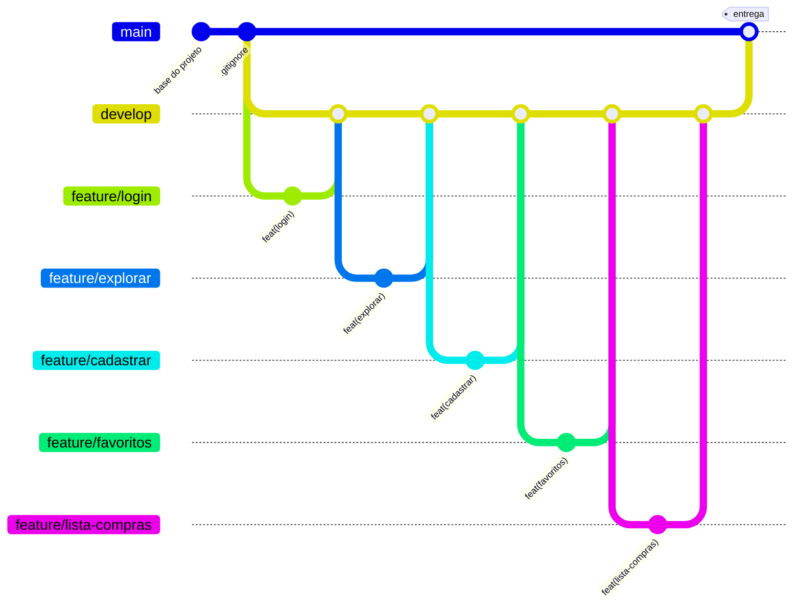

# Gitflow e organização

## Branches



| Branch | Para quê | Quem mexe |
|---|---|---|
| `main` | Versão estável, a que é entregue | Só recebe merge de `develop` no final |
| `develop` | Integração, onde as telas se juntam | Só recebe merge de PRs `feature/*` |
| `feature/<tela>` | Desenvolvimento de uma tela | O responsável pela tela |

**Regras do grupo**
1. Nunca commitar direto em `main` ou `develop`.
2. Toda feature nasce de `develop` atualizada e volta para `develop` via **Pull Request**.
3. Uma tela = uma branch = um PR.
4. Ao final, um PR `develop` → `main` fecha a entrega.

## Divisão do trabalho

| Tela | Responsável | Branch | Issue |
|---|---|---|---|
| Base do projeto | Fernando | `main` / `develop` | #2 |
| Login | Fernando | `feature/login` (PR #1) | #3 |
| Explorar | Bruno | `feature/explorar` | #4 |
| Cadastrar | Bruno | `feature/cadastrar` | #5 |
| Favoritos | Gabriel Frigo | `feature/favoritos` | #6 |
| Lista de compras | Gabriel Frigo | `feature/lista-compras` | #7 |
| Documentação | Fernando | `feature/docs` | — |
| Release `develop` → `main` | Fernando | — | #8 |

## Passo a passo de uma feature

```bash
git checkout develop
git pull                                   # develop sempre atualizada
git checkout -b feature/<tela>

# ...implementa/edita os arquivos da tela...

git status                                 # confere o que mudou
git add backend/routes/<tela>.py frontend/src/pages/<Tela>.jsx
git commit -m "feat(<tela>): implementa tela <Tela>"
git push -u origin feature/<tela>
```

Depois, no GitHub: **Compare & pull request** → base `develop` ← compare `feature/<tela>`.

## Padrão de commits

Seguimos o [Conventional Commits](https://www.conventionalcommits.org/pt-br/):

```
<tipo>(<escopo>): <descrição curta no imperativo>
```

| Tipo | Uso | Exemplo |
|---|---|---|
| `feat` | Nova funcionalidade | `feat(favoritos): implementa tela Favoritos` |
| `fix` | Correção de bug | `fix(explorar): busca ignorava acentos` |
| `docs` | Documentação | `docs: adiciona documentação do projeto` |
| `chore` | Estrutura e configuração | `chore: adiciona .gitignore` |
| `style` | Visual/CSS, sem mudar lógica | `style(lista-compras): ajusta espaçamento` |
| `refactor` | Reorganização sem mudar comportamento | `refactor(api): extrai função req` |

## Pull Requests

- **Título:** igual ao padrão de commit (ex.: `feat(cadastrar): tela Cadastrar`).
- **Descrição:** o que foi feito + **`Closes #<issue>`**. Isso vincula o PR à issue e ao quadro, e a issue fecha sozinha no merge.
- **Base:** sempre `develop` (o GitHub costuma sugerir `main`, então confira).
- Antes do merge, outra pessoa do grupo revisa.

## Quadro no GitHub Projects

Project **App de Receitas** (perfil do Fernando, vinculado ao repositório), no modelo Kanban:

| Coluna | Significado |
|---|---|
| Backlog | Ainda não pode ou não deve começar |
| Ready | Pronto para pegar |
| In progress | Alguém está trabalhando |
| In review | PR aberto, aguardando revisão/merge |
| Done | Mergeado na `develop` |

- Cada issue vira um card com o campo **Responsável** (Fernando, Bruno, Gabriel Frigo).
- Issues novas do repositório entram no quadro automaticamente.
- Ao começar uma tela, mova o card para **In progress**. Com `Closes #N` no PR, ele vai para **Done** quando o merge acontecer.
